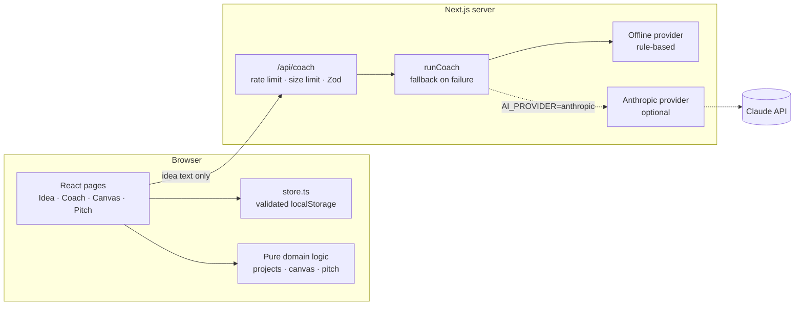

# LaunchLab AI

**From idea to startup.** An entrepreneurship learning app that walks a student from a rough idea to a plan they can defend: write the idea, get coached, map the business model, and build a pitch.


## What it does

| Step                      | What you get                                                                                                                                                                                                                                                                     |
| ------------------------- | -------------------------------------------------------------------------------------------------------------------------------------------------------------------------------------------------------------------------------------------------------------------------------- |
| **Idea Studio**           | Problem, audience, solution, differentiation, assumptions, and success criteria, with a status and autosave. Create, edit, duplicate, archive, and delete projects.                                                                                                              |
| **Startup Coach**         | Structured feedback: a problem-clarity score, customer-segment analysis, competitor research questions, differentiation and business-model suggestions, risks, validation experiments, and prioritized next steps. Ask follow-up questions. Every response is kept in a history. |
| **Business Model Canvas** | All nine blocks, each saved independently. Draft suggestions built from your idea, with a confirmation before anything you wrote is replaced. Prints on one landscape page.                                                                                                      |
| **Pitch Builder**         | Nine slides generated from your idea and canvas. Edit, reorder, preview as a presentation, and export to PDF. Slides containing statistics or absolute claims are flagged as unverified.                                                                                         |

The dashboard lists projects with progress, search, and filters, and can add a complete sample project (StudySwap, fictional).

| Coach                                | Canvas                                 | Pitch                                                |
| ------------------------------------ | -------------------------------------- | ---------------------------------------------------- |
|  |  |  |

## Run it

Requires Node.js 22 or newer.

```bash
npm install
npm run dev
```

Open http://localhost:3000. No environment variables, database, or API key are needed.

## The coach, and what "AI" means here

The app ships with two coaches behind one interface:

- **Offline coach (default).** Fixed rules applied to the text you wrote. It is deterministic, free, and makes no network calls. It is **not** an AI model, and the interface says so on every response.
- **AI coach (optional).** Sends your idea text to Claude through a server-side route. Off unless you configure it.

Both are told, by rule or by prompt, to label hypotheses, avoid invented statistics, and say what they could not know. If the AI coach fails for any reason, the request falls back to the offline coach and the response says that happened.

### Environment variables

Copy `.env.example` to `.env.local` only if you want the AI coach.

| Variable            | Default           | Purpose                                                                        |
| ------------------- | ----------------- | ------------------------------------------------------------------------------ |
| `AI_PROVIDER`       | `offline`         | `offline` or `anthropic`.                                                      |
| `ANTHROPIC_API_KEY` | none              | Required when `AI_PROVIDER=anthropic`. Server-side only. Using it costs money. |
| `AI_MODEL`          | `claude-opus-5-5` | Model for the AI coach.                                                        |

`GET /api/health` reports which coach is active.

## Architecture



- **Projects live in the browser.** `src/lib/store.ts` is the only code that touches `localStorage`. Everything read from storage is validated with Zod, one project at a time, so a damaged record cannot break the rest.
- **The server is stateless.** `/api/coach` receives idea text and returns feedback. It stores nothing.
- **One schema file.** `src/lib/schema.ts` defines every data shape; the browser, the API route, and the AI provider all validate against it.
- **Exports use the browser's print engine.** The canvas and pitch have print layouts; "Export PDF" opens the print dialog, where you choose "Save as PDF".

## Tests

```bash
npm test              # 44 unit and API tests (Vitest)
npx playwright install chromium   # once
npm run test:e2e      # 9 browser tests on desktop and mobile viewports (Playwright)
npm run check         # lint, typecheck, unit, and browser tests
```

The browser suite runs against the production build and covers the full journey (create, reload, coach, follow-up, canvas, pitch, reorder, preview, PDF export, duplicate, archive, delete), input validation, HTML-injection safety, isolation between browser profiles, API rejection of malformed input, and automated accessibility checks (axe) in light and dark themes with a check for sideways scrolling.

Last verified locally: lint clean, typecheck clean, 44/44 unit tests, 18/18 browser tests, production build passing. CI (`.github/workflows/ci.yml`) runs the same steps.

## Security and privacy

- **No accounts and no server database.** A project is readable only in the browser profile that created it. There is no shared or anonymous-writable data.
- **The API key never reaches the browser.** It is read only in server code, and the health endpoint reports the mode and model name only.
- **The coach route is bounded:** 12 requests per minute per client, 20 KB body limit, strict Zod validation, a 40-second timeout, and one retry.
- **User and model text is rendered as text,** never as HTML.
- Responses carry `X-Content-Type-Options`, `X-Frame-Options`, `Referrer-Policy`, and `Permissions-Policy` headers.

## Limitations

- **Your work is tied to one browser.** Clearing site data deletes it, and it does not sync between devices. There is no import or export of project files.
- **No authentication or database.** Prisma and PostgreSQL were left out on purpose: without accounts, a shared database would let anyone read or overwrite anyone's projects. Adding them means adding auth first.
- **The AI coach is not tested against the live API.** It is covered by tests with a stand-in client. Try it with your own key before relying on it.
- **Rate limits are per server instance** and reset on restart. Use a shared store before running more than one instance.
- **No Content-Security-Policy header yet.**
- **The claim checker is a pattern match.** It flags numbers and absolute words; it cannot tell whether a claim is true.
- **PDF export depends on the browser's print dialog.**
- When the AI coach is on, idea text is sent to Anthropic. Do not enable it for users under 18 without checking the consent rules that apply to you.

## Deployment

The app is a standard Next.js project and should run on Vercel or any Node host with `npm run build && npm start`. It has not been deployed. If you enable the AI coach on a public URL, anyone who finds it can spend your API credit up to the rate limit, so set a spending cap on the key first.

## Demo walkthrough

1. Open the dashboard and choose **Explore the demo project**.
2. In **Idea**, edit a field and watch "Saved in this browser".
3. In **Coach**, press **Get feedback**, then ask "How should I price this?".
4. In **Canvas**, clear a block, press **Suggest**, then press **Print or save as PDF**.
5. In **Pitch**, type "90% of students" into a slide to see the unverified-claim flag, reorder a slide, open **Preview**, then **Export PDF**.
6. Toggle the theme in the header.
