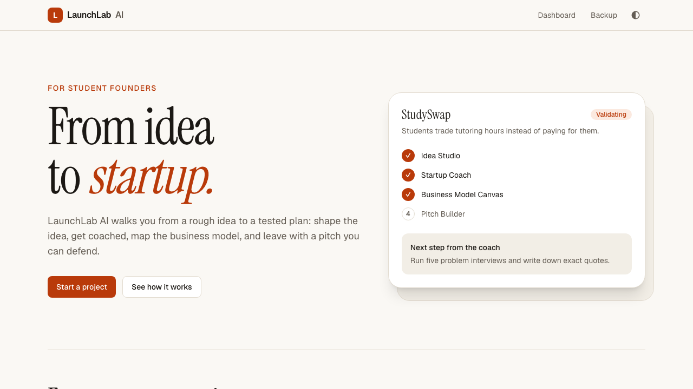
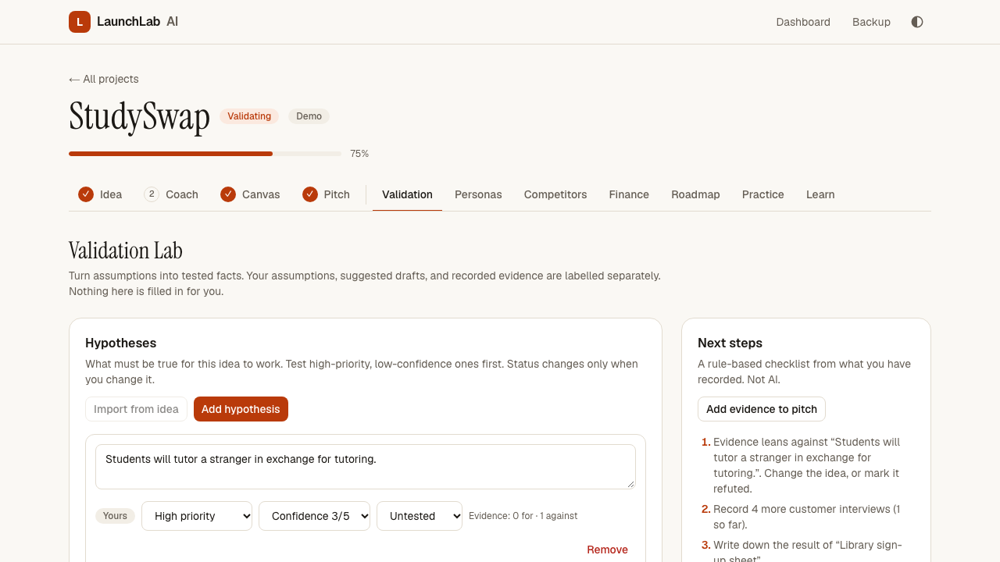
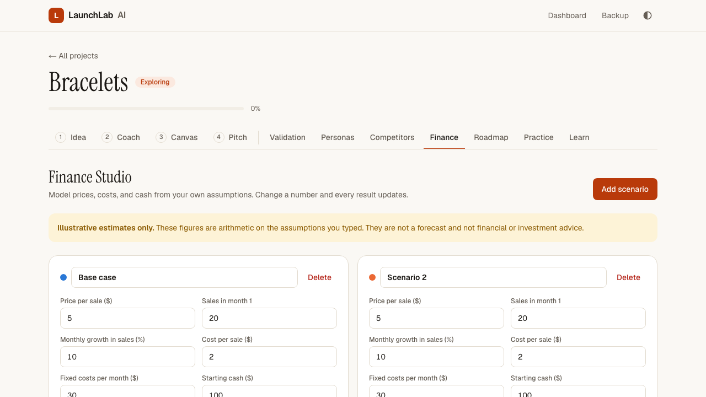
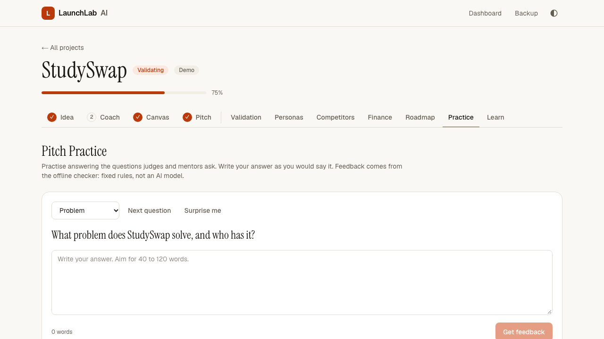
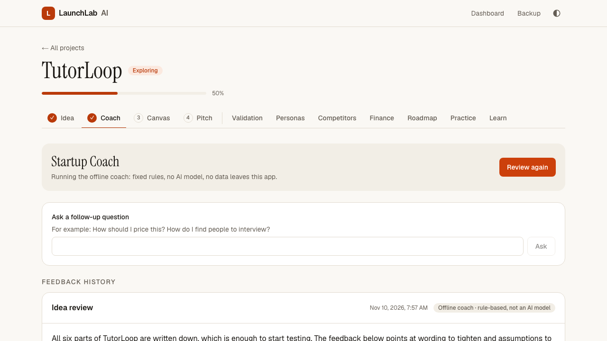
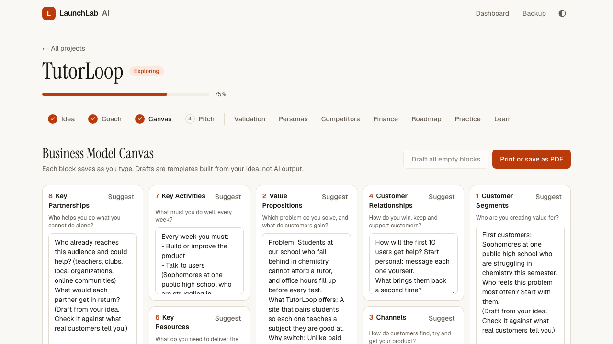
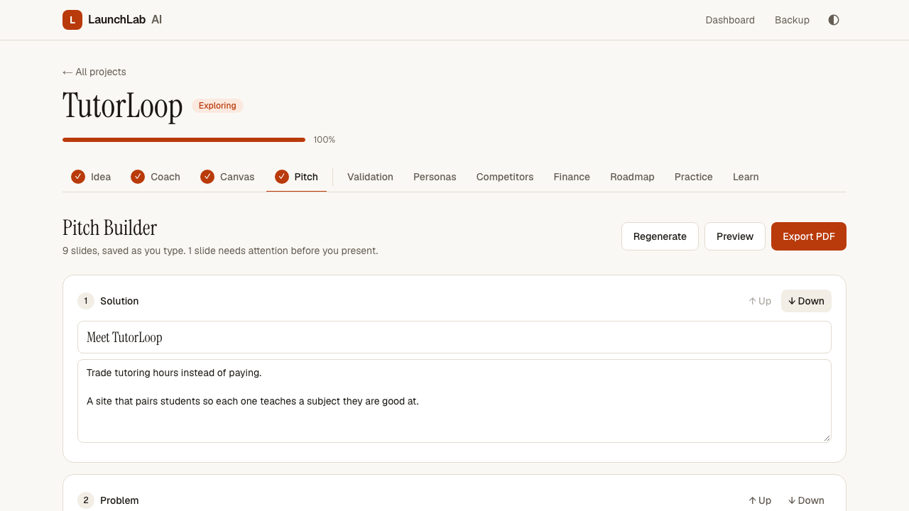
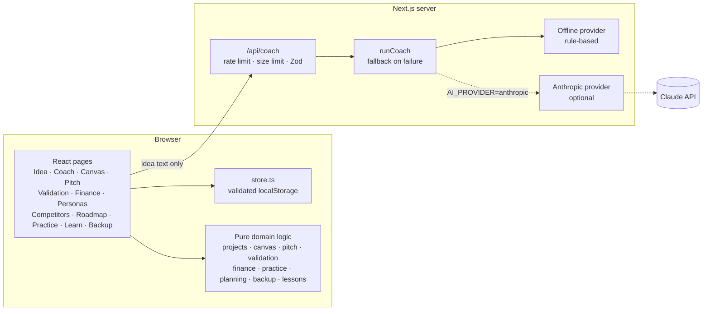

# LaunchLab AI

**From idea to startup.** An entrepreneurship learning app that walks a student from a rough idea to a plan they can defend: write the idea, get coached, test assumptions with real people, model the money, map the business model, and build and practise a pitch.



## What it does

| Step                      | What you get                                                                                                                                                                                                                                                                     |
| ------------------------- | -------------------------------------------------------------------------------------------------------------------------------------------------------------------------------------------------------------------------------------------------------------------------------- |
| **Idea Studio**           | Problem, audience, solution, differentiation, assumptions, and success criteria, with a status and autosave. Create, edit, duplicate, archive, and delete projects.                                                                                                              |
| **Startup Coach**         | Structured feedback: a problem-clarity score, customer-segment analysis, competitor research questions, differentiation and business-model suggestions, risks, validation experiments, and prioritized next steps. Ask follow-up questions. Every response is kept in a history. |
| **Business Model Canvas** | All nine blocks, each saved independently. Draft suggestions built from your idea, with a confirmation before anything you wrote is replaced. Prints on one landscape page.                                                                                                      |
| **Pitch Builder**         | Nine slides generated from your idea and canvas. Edit, reorder, preview as a presentation, and export to PDF. Slides containing statistics or absolute claims are flagged as unverified.                                                                                         |

### Project tools

Each tool belongs to one project and reads from it.

| Tool                    | What you get                                                                                                                                                                                                                                                                                                                                                                                                                               |
| ----------------------- | ------------------------------------------------------------------------------------------------------------------------------------------------------------------------------------------------------------------------------------------------------------------------------------------------------------------------------------------------------------------------------------------------------------------------------------------ |
| **Validation Lab**      | Hypotheses with priority, confidence and status; an interview guide built from a question bank; interview notes; a survey builder with response entry and summaries; an evidence board (supports / contradicts / neutral, linked to hypotheses); an experiment tracker; and rule-based next steps from what you recorded. Your assumptions, suggested drafts, and recorded evidence are labelled separately. Nothing is filled in for you. |
| **Finance Studio**      | Up to four pricing scenarios. Contribution margin, break-even sales, first profitable month, 12-month cash flow, runway, and a side-by-side comparison, with an interactive chart (hover or arrow keys) and a table view. Inputs are validated. Labelled as illustrative estimates, not advice.                                                                                                                                            |
| **Pitch Practice**      | Investor and mentor questions in six categories. Write an answer and get clarity and completeness scores, strengths, and improvements. History, averages, and advice that keeps recurring. Offline feedback is rule-based and labelled that way; the optional AI provider uses the same secure route.                                                                                                                                      |
| **Customer Personas**   | Up to six personas with who / goals / pains / needs / behaviors / motivations, each marked as an assumption or evidence-based. Draft one from your idea. Side-by-side comparison.                                                                                                                                                                                                                                                          |
| **Competitor Analysis** | Competitors and alternatives with source links (only http/https are ever linked), notes, strengths and weaknesses; a feature matrix; computed "only you / everyone else / shared" analysis; and a positioning statement. Nothing is looked up for you.                                                                                                                                                                                     |
| **MVP Roadmap**         | Tasks scored by impact ÷ effort, milestones with progress, a four-column board (moved with buttons, so it works by keyboard), and dependencies that mark tasks as blocked. Suggest MVP steps or import the coach's next steps.                                                                                                                                                                                                             |
| **Learning Hub**        | Five short lessons with quizzes and explanations. Each lesson links to a real task in your project and shows whether you have done it.                                                                                                                                                                                                                                                                                                     |
| **Backup Center**       | Export all projects or one to a versioned JSON file. Import with validation, a preview, and a choice of merge (duplicate ids become separate copies) or replace (with confirmation). Partly damaged files restore what they can.                                                                                                                                                                                                           |

### Moving information between tools

You stay in control: nothing is copied unless you press the button, and copying adds to your text rather than replacing it.

- Idea assumptions → Validation hypotheses. Idea text → persona drafts, positioning template, roadmap suggestions, practice questions.
- Validation evidence summary → the pitch's validation slide.
- Finance scenario → Revenue Streams and Cost Structure on the canvas, or the business-model slide.
- Persona → Customer Segments on the canvas. Positioning → Differentiation in Idea Studio.
- Coach next steps → roadmap tasks.

The dashboard lists projects with progress, search, and filters, shows tool progress on each card, and can add a sample project (StudySwap, fictional). The sample includes drafts and assumptions only: no invented interviews, responses, or evidence.

| Validation Lab                                         | Finance Studio                                         | Pitch Practice                                         |
| ------------------------------------------------------ | ------------------------------------------------------ | ------------------------------------------------------ |
|  |  |  |

| Coach                                | Canvas                                 | Pitch                                                |
| ------------------------------------ | -------------------------------------- | ---------------------------------------------------- |
|  |  |  |

## Run it

Requires Node.js 22 or newer.

```bash
npm install
npm run dev
```

Open http://localhost:3000. No environment variables, database, or API key are needed.

## The coach, and what "AI" means here

The app ships with two coaches behind one interface:

- **Offline coach (default).** Fixed rules applied to the text you wrote. It is deterministic, free, and makes no network calls. It is **not** an AI model, and the interface says so on every response.
- **AI coach (optional).** Sends your idea text to Claude through a server-side route. Off unless you configure it.

Both are told, by rule or by prompt, to label hypotheses, avoid invented statistics, and say what they could not know. If the AI coach fails for any reason, the request falls back to the offline coach and the response says that happened.

### Environment variables

Copy `.env.example` to `.env.local` only if you want the AI coach.

| Variable                      | Default           | Purpose                                                                        |
| ----------------------------- | ----------------- | ------------------------------------------------------------------------------ |
| `AI_PROVIDER`                 | `offline`         | `offline` or `anthropic`.                                                      |
| `ANTHROPIC_API_KEY`           | none              | Required when `AI_PROVIDER=anthropic`. Server-side only. Using it costs money. |
| `AI_MODEL`                    | `claude-opus-5-5` | Model for the AI coach.                                                        |
| `COACH_RATE_LIMIT_PER_MINUTE` | `12`              | Coach and practice requests allowed per client per minute (1–1000).            |

`GET /api/health` reports which coach is active.

## Architecture



- **Projects live in the browser.** `src/lib/store.ts` is the only code that touches `localStorage`. Everything read from storage is validated with Zod, one project at a time, so a damaged record cannot break the rest. The unreadable original is kept and can be downloaded from the Backup Center.
- **Every edit is validated before it is saved.** If a change would break the schema (for example a list past its limit), it is refused, so a stored project can never become unreadable.
- **Migrations are defaults.** Every field added after version 1 has a default, so projects saved by earlier versions load with empty tools. A test proves it.
- **The server is stateless.** `/api/coach` receives idea text and returns feedback. It stores nothing.
- **One schema file.** `src/lib/schema.ts` defines every data shape; the browser, the API route, and the AI provider all validate against it.
- **Exports use the browser's print engine.** The canvas and pitch have print layouts; "Export PDF" opens the print dialog, where you choose "Save as PDF".

## Tests

```bash
npm test              # 98 unit and API tests (Vitest)
npx playwright install chromium   # once
npm run test:e2e      # 16 browser tests, each on desktop and mobile viewports (Playwright)
npm run check         # lint, typecheck, unit, and browser tests
```

Unit tests cover every financial formula, validation summaries and next steps, practice scoring, backup round trips (merge, replace, duplicate ids, damaged and oversized files, newer formats), persona/competitor/roadmap logic, lessons, loading version-1 data, and refusal of invalid edits.

The browser suite runs against the production build and covers the full journey (create, reload, coach, follow-up, canvas, pitch, reorder, preview, PDF export, duplicate, archive, delete), every project tool's core workflow including the cross-tool buttons, export → delete → import, input validation, HTML-injection and `javascript:` link safety, keyboard use of the chart and board, isolation between browser profiles, the CSP header, API rejection of malformed input, and automated accessibility checks (axe) on all 13 screens in light and dark themes with a check for sideways scrolling.

Last verified locally: lint clean, typecheck clean, 98/98 unit tests, 32/32 browser test runs, production build passing. CI (`.github/workflows/ci.yml`) runs the same steps.

## Security and privacy

- **No accounts and no server database.** A project is readable only in the browser profile that created it. There is no shared or anonymous-writable data.
- **The API key never reaches the browser.** It is read only in server code, and the health endpoint reports the mode and model name only.
- **The coach route is bounded:** 12 requests per minute per client by default (shared by coaching and pitch practice), 20 KB body limit, strict Zod validation, a 40-second timeout, and one retry. Student text is wrapped in tags and the model is told to treat it as data, not instructions.
- **Imports are untrusted.** Backup files are size-limited (5 MB, 200 projects) and every project is re-validated against the current schema.
- **Links are filtered.** Competitor source links are rendered only if they are http or https, and open with `rel="noopener noreferrer"`.
- **User and model text is rendered as text,** never as HTML.
- Responses carry a Content-Security-Policy (everything restricted to this origin, no framing, no plugins) plus `X-Content-Type-Options`, `X-Frame-Options`, `Referrer-Policy`, and `Permissions-Policy` headers. The CSP allows inline scripts, because Next.js uses them for hydration and a nonce would force every page to render per request; it still blocks scripts and requests to any other host.

## Limitations

- **Your work is tied to one browser.** Clearing site data deletes it, and it does not sync between devices. Export a backup file to move or keep it.
- **No authentication or database.** Prisma and PostgreSQL were left out on purpose: without accounts, a shared database would let anyone read or overwrite anyone's projects. Adding them means adding auth first.
- **The AI coach is not tested against the live API.** It is covered by tests with a stand-in client. Try it with your own key before relying on it.
- **Rate limits are per server instance** and reset on restart. Use a shared store before running more than one instance.
- **The CSP allows inline scripts** (see Security above).
- **Pitch practice and the offline coach are pattern checks.** They judge length, wording, and whether expected points are mentioned. They cannot tell whether an answer is true or persuasive.
- **Finance is a simple model:** constant price and costs, compounding monthly growth, no taxes, payment timing, or one-off costs.
- **The board moves cards with buttons,** not drag and drop.
- **Storage is bounded per project** by schema limits, but the number of projects is not; the browser's own quota (about 5 MB) is the ceiling, and a banner appears if saving fails.
- **The claim checker is a pattern match.** It flags numbers and absolute words; it cannot tell whether a claim is true.
- **PDF export depends on the browser's print dialog.**
- When the AI coach is on, idea text is sent to Anthropic. Do not enable it for users under 18 without checking the consent rules that apply to you.

## Deployment

The app is a standard Next.js project and should run on Vercel or any Node host with `npm run build && npm start`. It has not been deployed. If you enable the AI coach on a public URL, anyone who finds it can spend your API credit up to the rate limit, so set a spending cap on the key first.

## Demo walkthrough

1. Open the dashboard and choose **Explore the demo project**.
2. In **Idea**, edit a field and watch "Saved in this browser".
3. In **Coach**, press **Get feedback**, then ask "How should I price this?".
4. In **Canvas**, clear a block, press **Suggest**, then press **Print or save as PDF**.
5. In **Pitch**, type "90% of students" into a slide to see the unverified-claim flag, reorder a slide, open **Preview**, then **Export PDF**.
6. In **Validation**, add a piece of evidence that contradicts a hypothesis and watch the next steps change, then press **Add evidence to pitch**.
7. In **Finance**, change the cost per sale to more than the price to see break-even become impossible, then hover the chart.
8. In **Practice**, answer a question and read the feedback and its "rule-based" label.
9. In **Backup**, export everything, delete the project from the dashboard, and import the file back.
10. Toggle the theme in the header.
